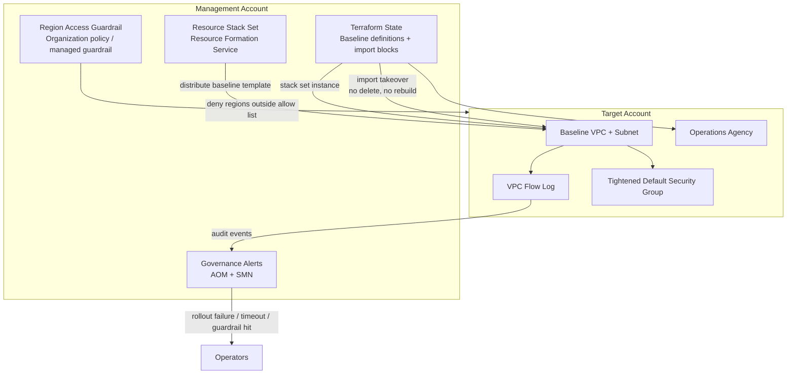

# lean-governance-landing-zone-migration-toolkit / Multi-Account Landing Zone Baseline Governance Handover Toolkit

[](LICENSE)
[](https://support.huaweicloud.com/intl/en-us/)
[](#)

> A complete operation sequence and IaC artifacts for handing over account-level baseline governance in a multi-account landing zone

---

## 1. Overview

This practice provides **takeover-based handover of multi-account governance baselines**. It moves account-level baseline configuration — network baseline, flow logs, operations agency, region access guardrail — from "distributed by a stack set" to "declared and managed by Terraform". The whole flow follows a **takeover, not rebuild** principle: existing baseline resources are neither deleted nor recreated; they are first brought under Terraform state, then ownership is handed over account by account, and finally the old mechanism is retired safely. It targets platform engineering, DevOps and security operations engineers, and can be used as a reference architecture, a learning sample, or a production template.

### Core Capabilities

- **Declarative takeover**: existing baseline resources are brought under state through import blocks; all changes are visible at plan time, and drift detection is automated
- **Multi-account rollout**: a resource stack set distributes the same baseline to multiple accounts and regions, with instance creation wired into the Terraform lifecycle
- **Region access guardrail**: two paths available — direct organization policy management (with dry run) and managed governance guardrail — both deny calls to regions outside the allow list
- **Zero-drift verification**: after takeover the plan output must read `N to import, 0 to add, 0 to change, 0 to destroy`
- **Safe retirement**: a five-step retirement sequence with observation windows between steps, the last step irreversible and archived for audit

---

## 2. Table of Contents

- [1. Overview](#1-overview)
- [2. Table of Contents](#2-table-of-contents)
- [3. Architecture Diagram](#3-architecture-diagram)
- [4. Highlights](#4-highlights)
- [5. Cloud Services Used](#5-cloud-services-used)
- [6. Prerequisites](#6-prerequisites)
- [7. Quick Start](#7-quick-start)
- [8. Step-by-Step Deployment](#8-step-by-step-deployment)
- [9. Usage / Verification](#9-usage--verification)
- [10. Cleanup](#10-cleanup)
- [11. Detailed Explanation](#11-detailed-explanation)
- [12. Dependencies](#12-dependencies)
- [13. FAQ / Troubleshooting](#13-faq--troubleshooting)
- [14. Contributing](#14-contributing)
- [15. License](#15-license)
- [16. Contact / Maintainers](#16-contact--maintainers)

---

## 3. Architecture Diagram

> Baseline resources move from "distributed by a stack set" to "declared and taken over by Terraform"; the takeover does not interrupt the network and logging baselines inside the account.



**Key components**:
- **Terraform state**: the single source of truth for baseline resources. Resource definitions match the live state attribute by attribute, which is what makes zero-drift verification possible
- **Resource stack set**: distributes one baseline template to many accounts and regions; creation and deletion of stack set instances are both wired into the Terraform lifecycle
- **Region access guardrail**: denies calls to regions outside the allow list. The organization policy path offers dry run; the managed guardrail path needs no cross-account organization-level permission
- **VPC flow log**: the data source of the audit trail, delivered to an LTS log group and log stream
- **Governance alerts**: rollout failure, rollout timeout and guardrail-triggered events converge on one notification topic

---

## 4. Highlights

- **Takeover, not rebuild**: existing baseline resources enter state through import, never deleted and never recreated, avoiding the interruption of network and logging baselines that a baseline rebuild would cause
- **Changes move ahead of deployment**: every change is visible at plan time, and drift is detected by Terraform instead of being found by after-the-fact comparison
- **Hand-over order is enforced**: stack set instances cannot be removed before takeover completes and passes zero-drift verification; the scripts carry a confirmation gate
- **Guardrail runs a dry run first**: organization policies support dry run, so the impact on existing accounts can be assessed before enforcement
- **Retirement leaves a trail**: a five-step retirement sequence archives the irreversible end state for later audit

---

## 5. Cloud Services Used

| Service | Purpose | Notes |
|---|---|---|
| Resource Formation Service (RFS) | Resource stack sets: distribute baselines to many accounts and regions | Stack set instances are created by script and wired into the lifecycle |
| Resource Governance Center (RGC) | Managed governance guardrails, account enrollment, organizational units | Optional path, depending on the guardrail approach |
| Organizations | Organization policy, attachment and dry run | The organization-policy path of the region guardrail |
| Identity and Access Management (IAM) | Operations agency | Account-type agency naming the management account allowed to assume it |
| Virtual Private Cloud (VPC) | Baseline VPC, subnet and flow log | One set per governed account |
| Log Tank Service (LTS) | Delivery destination for flow logs | Log group plus log stream |
| Simple Message Notification (SMN) | Governance alert notifications | Topic plus subscription |
| Application Operations Management (AOM) | Alert policies and rules for the governance pipeline | Three alert rules |
| Data Encryption Workshop (DEW) | External storage for sensitive baseline parameters | Generic-type secret, read per version |
| Object Storage Service (OBS) | Storage for stack set templates and Terraform state | Templates must be readable from the intranet |

> **Tip**: all services can be created with a single Terraform apply in this repository; for cleanup see [Section 10 "Cleanup"](#10-cleanup).

---

## 6. Prerequisites

| Item | Requirement | Notes |
|---|---|---|
| **Account** | A registered and real-name verified Huawei Cloud account | An enterprise organization relationship must already exist |
| **Permissions** | IAM **Tenant Administrator** or equivalent | Required to create VPCs, organization policies, stack sets |
| **Region** | `cn-north-4` recommended | Multi-region deployment needs one provider alias per region |
| **Terraform** | `>= 1.7.0` | IaC tool |
| **huaweicloud Provider** | `>= 1.97.0` | Huawei Cloud Terraform Provider |
| **Python** | `>= 3.8` | Stack set instance management and resource verification scripts |
| **PyYAML** | `>= 5.4` | YAML parsing dependency of the manifest extraction script |
| **AK/SK** | Obtain the Access Key ID and Secret Access Key from the Huawei Cloud "My Credentials" page and fill them into the deployment scripts | **Do not** write credentials into any code or configuration file |
| **Organization permissions** | An organization exists and you can manage organization policies | Needed to attach the region access guardrail |
| **Stack set permissions** | The administration agency must hold `iam:tokens:assume` | This permission is often granted separately by an account holding Security Administrator |

---

## 7. Quick Start

### One-command deployment (recommended)

```bash
# 1. Clone this repository
git clone https://github.com/huaweicloud-samples/lean-governance-landing-zone-migration-toolkit.git lean-governance-landing-zone-migration-toolkit
cd lean-governance-landing-zone-migration-toolkit

# 2. Prepare Huawei Cloud AK/SK (see [Prerequisites §6](#6-prerequisites))
export HW_ACCESS_KEY="<your-access-key>"
export HW_SECRET_KEY="<your-secret-key>"

# 3. Deploy
cd infra
terraform init
terraform plan
terraform apply -auto-approve
```

> **Deployment time**: about 3-5 minutes, depending on the number of resources.
> **Full steps and expected output per step**: see [Section 8 "Step-by-Step Deployment"](#8-step-by-step-deployment).

---

## 8. Step-by-Step Deployment

### Step 1: Initialize the working directory

```bash
cd lean-governance-landing-zone-migration-toolkit/infra
terraform init
```

**Expected output**: `Terraform has been successfully initialized!`

### Step 2: Preview the resource changes

```bash
terraform plan
```

**Expected output**: `Plan: N to add, 0 to change, 0 to destroy.`

### Step 3: Apply the deployment

```bash
terraform apply -auto-approve
```

**Expected output**: `Apply complete! Resources: N added, 0 changed, 0 destroyed.`

### Step 4: Record the key outputs

```bash
terraform output
```

**Expected output**: lists all `output` values (baseline VPC ID, subnet ID, flow log ID, guardrail policy ID, stack set name, and so on). Keep them for the verification steps below.

---

## 9. Usage / Verification

> **Mandatory live testing**: The commands / examples listed in this section were actually executed before delivery; they run and their output matches the description. After deployment, follow these steps to verify that the business functionality works before considering the delivery complete.

### Verification 1: Presence of baseline resources

```bash
# Check that the baseline VPC, subnet, flow log and agency are all present in the account
python3 scripts/verify-account-resources.py \
  --region cn-north-4 \
  --expect-vpc 10.0.0.0/16 \
  --expect-subnet 10.0.1.0/24 \
  --expect-flow-log \
  --expect-agency landing-zone-governance-ops-agency
```

**Expected output**:
```
=== 资源对等校验 ===
区域: cn-north-4

✓ 基线 VPC 存在 —— CIDR=10.0.0.0/16，名称=landing-zone-governance-vpc
✓ 基线子网存在 —— CIDR=10.0.1.0/24
✓ VPC 流日志已启用 —— 共 1 条处于启用状态
✓ 基线委托存在 —— 名称=landing-zone-governance-ops-agency

通过 4 项，失败 0 项
```

### Verification 2: Zero drift on takeover

```bash
# After taking over existing baseline resources, confirm the plan contains only import entries
./scripts/verify-takeover.sh infra/takeover
```

**Expected output**:
```
待接管 (to import): 5
待新增 (to add):    0
待变更 (to change): 0
待删除 (to destroy): 0
需重建 (replace):   0

✓ 校验通过：5 个对象待接管，其余无任何变更
```

### Verification 3: Manifest extraction

```bash
# Parse the declarative manifest into a structured inventory
python3 scripts/extract-manifest.py scripts/baseline-manifest.yaml json
```

**Expected output**:
```json
{
  "total_accounts": 2,
  "total_customizations": 3,
  "customizations": [
    {
      "account_id": "0000000000000001",
      "account_name": "workload-dev-001",
      "organizational_unit": "Workloads/Development",
      "template": "baseline-network",
      "parameters": "log_retention_days=30;subnet_cidr=10.0.1.0/24;vpc_cidr=10.0.0.0/16",
      "regions": "cn-north-4",
      "region_count": 1
    }
  ]
}
```

### Verification 4: Stack set instance status

```bash
# List the instances under the stack set and confirm the rollout target and instance status
python3 scripts/rfs_stack_instance.py list --stack-set landing-zone-governance-baseline
```

**Expected output**:
```
  账号=0000000000000001 区域=cn-north-4 状态=CREATE_COMPLETE
共 1 个栈集实例
```

### Verification 5: Guardrail takes effect

```bash
# Issue a call in a region outside the allow list; it must be rejected
# Switch the target region in the console and run any resource query
```

**Expected result**: the call is rejected by the guardrail and the console returns a region-not-authorized error; the same account works normally in an allow-listed region.

### Verification 6: End-to-end governance flow (recommended)

```bash
# Walk the whole chain: inventory, takeover, handover, retirement
./scripts/extract-manifest.sh scripts/baseline-manifest.yaml csv
./scripts/verify-takeover.sh infra/takeover
./scripts/remove-stack-instances.sh --stack-set landing-zone-governance-baseline \
  --account-id 0000000000000001 --regions cn-north-4
python3 scripts/verify-account-resources.py --region cn-north-4 \
  --expect-vpc 10.0.0.0/16 --expect-flow-log
```

**Expected result**: the inventory covers every account and customization; the takeover check shows zero drift; after the instance is removed the baseline resource check still passes completely — the underlying resources were not deleted along with it.

---

## 10. Cleanup

```bash
# Enter the deployment directory
cd lean-governance-landing-zone-migration-toolkit/infra

# Release all resources at once
terraform destroy -auto-approve
```

**Expected output**: `Destroy complete! Resources: N destroyed.`

> **Avoiding leftovers**:
> - `terraform destroy` only releases resources tracked in the Terraform state;
> - resources created directly through the API (objects uploaded by hand, EIPs created in the console, and so on) must be released manually;
> - shared resources (NAT gateways, VPCs used by other tasks in the same account) are not affected.

---

## 11. Detailed Explanation

### Workflow

This practice covers a complete governance baseline handover in five stages:

| Stage | Action | Key artifact |
|---|---|---|
| Inventory | Distill the organization-wide baselines into a structured manifest | Output of `scripts/extract-manifest.py` |
| Plan | Determine which accounts and which baseline items need handover | Manifest in JSON / CSV |
| Take over | Import existing baseline resources into state, verify zero drift in plan | `infra/takeover/import-blocks.tf` + `infra/takeover/adopted.tf` + `scripts/verify-takeover.sh` |
| Hand over | Remove stack set instances; resource ownership moves to local state | `scripts/remove-stack-instances.sh` |
| Retire | Tear down the old mechanism in five steps, archiving the final state | `scripts/decommission.sh` |

**Why the order cannot be reversed**: when a stack set instance is removed, the resources it holds go down with it. If the resources have not yet been taken over into local state, removing the instance deletes the baseline resources outright — the network baseline and flow logs break immediately. `remove-stack-instances.sh` therefore carries a confirmation gate requiring the operator to declare that the account's resources have been taken over, and immediately prints the resource verification command afterwards.

### Two paths for the region access guardrail

| Path | How it lands | When to use |
|---|---|---|
| Direct organization policy management | The policy content lives in the repository and follows the Terraform lifecycle; a dry run assesses impact on existing accounts before it is attached to an organizational unit | You need full control over policy content and attachment target, and policy changes should go through code review |
| Managed governance guardrail | Executed by the built-in governance policy of Resource Governance Center | You do not hold cross-account organization-level permissions, or you prefer the standard semantics of the managed policy |

The policy content of both paths expresses the same thing: deny every call made from regions outside the allow list.

### Account enrollment and identity reference

Account enrollment is carried by Resource Governance Center. During enrollment, `identity_store_email` and `identity_store_user_name` identify the account's user in Identity and Access Management, so neither new account provisioning nor enrollment of existing accounts needs separate identity center resources.

### Configuration

| Variable | Default | Description |
|---|---|---|
| `region` | `cn-north-4` | Deployment region |
| `project_name` | `landing-zone-governance` | Resource name prefix |
| `vpc_cidr` | `10.0.0.0/16` | Baseline VPC CIDR |
| `subnet_cidr` | `10.0.1.0/24` | Baseline subnet CIDR |
| `approved_regions` | `["cn-north-4", "cn-east-3"]` | Regions allowed by the guardrail |
| `organization_root_id` | `""` | Organization root ID, used to attach organization policies |
| `target_organizational_unit_id` | `""` | Organizational unit the guardrail attaches to |
| `agency_trusted_account_id` | `""` | Management account allowed to assume the baseline agency |
| `enable_stack_set` | `false` | Whether to create the stack set and roll out |
| `stack_set_target_account_ids` | `[]` | Accounts targeted by the stack set |
| `stack_set_template_file` | `""` | Baseline template file path (relative to `infra/`); when set, the template is submitted together with the stack set |
| `stack_set_template_url` | `""` | Baseline template address (alternative to the previous one) |
| `stack_set_permission_model` | `SELF_MANAGED` | Stack set permission model: `SELF_MANAGED` (self-managed) / `SERVICE_MANAGED` (service-managed; requires the account to belong to an organization) |
| `stack_set_administration_agency_name` | `""` | Administration agency name (required for rollout) |
| `stack_set_managed_agency_name` | `""` | Managed agency name (required in self-managed mode) |
| `stack_set_enable_force_new` | `""` | Replacement strategy on template change; set to `"true"` to destroy and rebuild the stack set |
| `guardrail_mode` | `organizations_policy` | Guardrail path: direct organization policy / managed governance control |
| `dry_run_target_entity_id` | `""` | Target entity ID for the organization policy dry run |
| `managed_guardrail_identifier` | `RGC.REGION_LIMIT` | Identifier of the managed governance control |
| `enable_monitoring` | `false` | Whether to create governance alarm rules (the interface is unavailable in some regions, so it is off by default) |
| `enable_multi_region` | `false` | Whether to land an independent baseline in each additional region |
| `enable_sensitive_params` | `false` | Whether to create the secret holding sensitive parameters |
| `log_retention_days` | `30` | Log retention in days |
| `notification_recipients` | `[]` | Alert subscription addresses |

### API

Stack set instance management goes through the Resource Formation Service interfaces, wrapped by `scripts/rfs_stack_instance.py`:

| Operation | Method and path |
|---|---|
| Create instance | `POST /v1/stack-sets/{name}/stack-instances` |
| Delete instance | `POST /v1/stack-sets/{name}/stack-instances/deletion` |
| List instances | `GET /v1/stack-sets/{name}/stack-instances` |
| Query operation status | `GET /v1/stack-sets/{name}/operations/{id}/metadata` |

---

## 12. Dependencies

### Main dependencies

| Name | Version | Purpose |
|---|---|---|
| Terraform | `>= 1.7.0` | IaC orchestration |
| huaweicloud Provider | `>= 1.97.0` | Huawei Cloud resources |
| Python | `>= 3.8` | Stack set instance management and resource verification scripts |
| PyYAML | `>= 5.4` | Manifest parsing |

---

## 13. FAQ / Troubleshooting

### Q1: The deployment reports insufficient permission. What should I do?

**A**: Confirm the account holds IAM **Tenant Administrator** permissions. Stack set rollout additionally requires the administration agency to hold `iam:tokens:assume`. That permission is domain-scoped, so a regular IAM sub-account cannot attach it by itself — it has to be granted by an account holding Security Administrator.

### Q2: The stack set and its deployment were created, but the target account has no resources at all?

**A**: The stack set definition and the stack set deployment only answer "which template, to whom, and where to deploy it". **Creating an instance is a separate action.** This repository wires instance creation into the lifecycle through `terraform_data` plus `local-exec` calling `scripts/rfs_stack_instance.py`; check the output of that step. If it was skipped, run it manually:

```bash
python3 scripts/rfs_stack_instance.py create \
  --stack-set landing-zone-governance-baseline \
  --account-ids 0000000000000001 \
  --regions cn-north-4
```

### Q3: The takeover check reports "non-takeover changes present". What should I do?

**A**: The local resource definitions differ from the live state, so **do not run apply** — apply would overwrite the live configuration with the local definition. Compare the drift-prone fields one by one: tags, encryption settings, description, enabled flags, retention period. Correct the definitions and re-run the check.

### Q4: The resources disappeared after I removed the stack set instance. What now?

**A**: This is the outcome to avoid. Takeover must complete and pass zero-drift verification before any instance is removed. If it already happened, check the resource stack list of that account in the console for the resource state, and recover from the resource stack snapshot. **From now on, always take over first and remove afterwards.**

### Q5: The region guardrail is attached but does not take effect?

**A**: First confirm which path is in use. For the organization policy path, check that the policy is attached to the target organizational unit and whether the dry run has completed; for the managed guardrail path, check that the guardrail state is enabled. Also make sure the region condition key format matches the format of the region actually requested.

### Q6: No flow log data is arriving?

**A**: Confirm the flow log is enabled and that the log group and log stream exist (`terraform output log_group_id` / `log_stream_id`). Data is purged once the log stream retention period expires.

### Troubleshooting checklist

| Symptom | Likely cause | How to investigate |
|---|---|---|
| Stack set apply succeeds but the account has no resources | The instance creation step did not run or failed | Check the output of `rfs_stack_instance.py`; confirm instances with the `list` subcommand |
| Stack set creation reports a permission error | The administration agency lacks `iam:tokens:assume` | Have an account with Security Administrator grant the permission |
| Takeover check keeps reporting drift | Resource definitions differ from the live state | Compare actual attributes with `terraform state show` |
| Guardrail does not block out-of-allow-list calls | Policy not attached, or the condition key format is wrong | Check the attachment state and the condition key |
| The script reports a missing dependency | PyYAML is not installed | `pip install pyyaml` |
| No flow log data | The log stream expired, or the flow log is disabled | Check the retention period and the flow log state |

---

## 14. Contributing

Issues and pull requests are welcome. Please follow this flow:

1. **Issue**: describe the problem or proposal (with reproduction commands, expected / actual output, screenshots)
2. **PR**: branch from `main`; run `terraform validate` and `terraform fmt -check` before submitting

See `CONTRIBUTING.md` (if present) for details.

---

## 15. License

This practice is released under the **MIT No Attribution** license. See the [`LICENSE`](LICENSE) file in the repository root.

```
MIT No Attribution

Copyright (c) Huawei Cloud

Permission is hereby granted, free of charge, to any person obtaining a copy
of this software... (no attribution required)
```

---

## 16. Contact / Maintainers
| Item | Content |
|---|---|
| **Creator** | [dgc-git](https://github.com/dgc-git) |
| **Maintainer** | [dgc-git](https://github.com/dgc-git) |
| **Contact** | GitHub Issues / PR (see [Section 14](#14-contributing)) |
