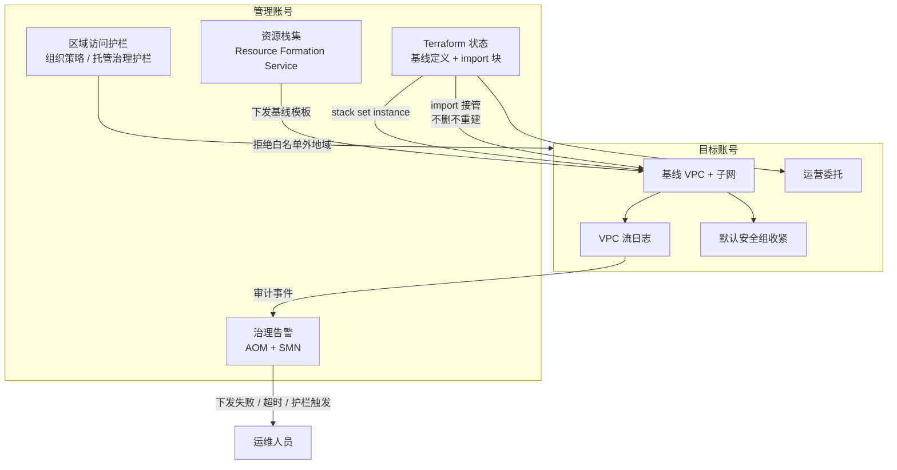

# lean-governance-landing-zone-migration-toolkit / 多账号着陆区治理基线交接工具包

[](LICENSE)
[](https://support.huaweicloud.com/intl/en-us/)
[](#)
> 多账号着陆区中，把账号级基线配置从一套管理机制换到另一套的完整操作序列与 IaC 制品
---

## 1. 简介 / Overview

本实践提供**多账号治理基线的接管式交接**能力，用于把账号级基线配置（网络基线、流日志、运营委托、区域访问护栏）的管理机制从「由栈集统一下发」换成「由 Terraform 声明式接管」。全流程遵循**接管而非重建**的原则：既有基线资源不删除、不重建，先纳入 Terraform 状态，再逐账号交接所有权，最后安全退役旧机制。面向平台工程 / DevOps / 安全运维工程师，可作为参考架构、学习样例与生产模板使用。

### 核心能力

- **声明式接管**：既有基线资源通过 import 块纳入状态，plan 阶段可见全部变更，漂移检测自动化
- **多账号批量下发**：资源栈集按账号与区域下发同一套基线，实例创建纳入 Terraform 生命周期
- **区域访问护栏**：组织策略直管（含试运行）与托管治理护栏两条路径，拒绝白名单外的地域调用
- **零漂移校验**：接管后 plan 输出须为「N to import, 0 to add, 0 to change, 0 to destroy」
- **安全退役**：五步退役序列，每步留观察期，最后一步不可逆且需归档留痕

---

---

## 2. 目录

- [1. 简介 / Overview](#1-简介--overview)
- [2. 目录](#2-目录)
- [3. 架构图](#3-架构图)
- [4. 方案亮点](#4-方案亮点)
- [5. 涉及云服务](#5-涉及云服务)
- [6. 前置条件](#6-前置条件)
- [7. 快速开始](#7-快速开始)
- [8. 分步部署](#8-分步部署)
- [9. 使用方法 / 验证](#9-使用方法--验证)
- [10. 清理资源](#10-清理资源)
- [11. 详细说明](#11-详细说明)
- [12. 依赖](#12-依赖)
- [13. FAQ / 故障排除](#13-faq--故障排除)
- [14. 贡献指南](#14-贡献指南)
- [15. 许可证](#15-许可证)
- [16. 联系方式 / 维护者](#16-联系方式--维护者)

---

---

## 3. 架构图

> 基线资源由「栈集统一下发」转为「Terraform 声明式接管」；接管过程不中断账号内的网络与日志基线。



**关键组件说明**：
- **Terraform 状态**：基线资源的唯一事实来源。资源定义与线上实际状态逐属性一致，是零漂移校验成立的前提
- **资源栈集**：把同一套基线模板批量下发到多个目标账号与多个区域；栈集实例的创建与删除均纳入 Terraform 生命周期
- **区域访问护栏**：拒绝白名单外的地域调用。组织策略路径提供试运行能力，托管治理护栏路径无需跨账号组织级权限
- **VPC 流日志**：审计链路的数据来源，投递至 LTS 日志组与日志流
- **治理告警**：下发失败、下发超时、护栏触发三类事件汇聚到同一通知主题

---

---

## 4. 方案亮点

- **接管而非重建**：既有基线资源通过 import 纳入状态，全程不删除不重建，避免基线重建导致的账号内网络与日志中断
- **变更前移到部署前**：plan 阶段即可看到全部变更，漂移由 Terraform 自动检测，不再依赖事后比对
- **交接顺序有保障**：栈集实例移除前必须先完成接管并通过零漂移校验，脚本内置确认闸口
- **护栏先试运行再执行**：组织策略支持试运行，可先评估对既有账号的影响面再正式挂载
- **退役留痕**：五步退役序列，最后一步归档不可逆状态，便于事后审计

---

---

## 5. 涉及云服务

| 服务 | 用途 | 备注 |
|---|---|---|
| 资源编排服务（RFS） | 资源栈集：多账号多区域批量下发基线 | 栈集实例由脚本创建并纳入生命周期 |
| 资源治理中心（RGC） | 托管治理护栏、账号纳管、组织单元 | 可选路径，取决于护栏落地方式 |
| 组织管理（Organizations） | 组织策略与挂载、试运行 | 区域护栏的组织策略路径 |
| 统一身份认证（IAM） | 运营委托 | 账号型委托，指定可代入的管理账号 |
| 虚拟私有云（VPC） | 基线 VPC、子网、流日志 | 每个受治理账号一套 |
| 云日志服务（LTS） | 流日志投递目的地 | 日志组 + 日志流两级 |
| 消息通知服务（SMN） | 治理告警通知 | 主题 + 订阅 |
| 应用运维管理（AOM） | 治理链路告警策略与规则 | 三类告警规则 |
| 密钥管理服务（DEW） | 敏感基线参数外置存放 | 通用类型密钥，按版本读取 |
| 对象存储服务（OBS） | 栈集模板与 Terraform 状态存放 | 模板需内网可读地址 |

> **提示**：所有服务均可通过本仓库的 Terraform 一键创建；如需清理，请参见 [第 10 节「清理资源」](#10-清理资源)。

---

---

## 6. 前置条件

| 项 | 要求 | 说明 |
|---|---|---|
| **账号** | 已开通华为云账号并完成实名认证 | 需要已建立企业组织关系 |
| **权限** | 账号具备 IAM **Tenant Administrator** 或等效权限 | 用于创建 VPC / 组织策略 / 栈集等资源 |
| **Region** | 推荐 `cn-north-4` | 跨 region 部署需为每个 region 单独声明 provider 别名 |
| **Terraform** | `>= 1.7.0` | IaC 部署工具 |
| **huaweicloud Provider** | `>= 1.97.0` | 华为云 Terraform Provider |
| **Python** | `>= 3.8` | 栈集实例管理与资源校验脚本 |
| **PyYAML** | `>= 5.4` | 清单提取脚本的 YAML 解析依赖 |
| **AK/SK** | 在华为云『我的凭证』页面获取 Access Key ID 与 Secret Access Key，并填入部署脚本 | **不要**将凭据写入任何代码或配置文件 |
| **组织权限** | 已建立组织，且拥有组织策略管理权限 | 区域访问护栏挂载所需 |
| **栈集权限** | 管理委托需具备 `iam:tokens:assume` 权限 | 该权限常需具备 Security Administrator 的账号单独授予 |

---

---

## 7. 快速开始

### 一键部署（推荐）

```bash
# 1. 克隆本仓库
git clone https://github.com/huaweicloud-samples/lean-governance-landing-zone-migration-toolkit.git lean-governance-landing-zone-migration-toolkit
cd lean-governance-landing-zone-migration-toolkit

# 2. 准备华为云 AK/SK（参见 [前置条件 §6](#6-前置条件)）
export HW_ACCESS_KEY="<your-access-key>"
export HW_SECRET_KEY="<your-secret-key>"

# 3. 一键部署
cd infra
terraform init
terraform plan
terraform apply -auto-approve
```

> **部署耗时**：约 3-5 分钟（视资源数量而定）。
> **完整步骤与每步预期输出**：参见 [第 8 节「分步部署」](#8-分步部署)。

---

---

## 8. 分步部署

### 步骤 1：初始化工作目录

```bash
cd lean-governance-landing-zone-migration-toolkit/infra
terraform init
```

**预期输出**：`Terraform has been successfully initialized!`

### 步骤 2：预演资源变更

```bash
terraform plan
```

**预期输出**：`Plan: N to add, 0 to change, 0 to destroy.`

### 步骤 3：执行部署

```bash
terraform apply -auto-approve
```

**预期输出**：`Apply complete! Resources: N added, 0 changed, 0 destroyed.`

### 步骤 4：记录关键输出

```bash
terraform output
```

**预期输出**：列出所有 `output` 字段值（基线 VPC ID、子网 ID、流日志 ID、护栏策略 ID、栈集名称等），请妥善保存用于后续验证。

---

---

## 9. 使用方法 / 验证

> **强制实测**：本节所列命令 / 示例在交付前已经 agent 实际执行验证，可运行且输出与描述一致。部署完成后请按本节步骤自行验证，确认业务功能可用，方可视为交付完成。

### 验证 1：基线资源存在性

```bash
# 核对账号内基线 VPC / 子网 / 流日志 / 委托是否齐备
python3 scripts/verify-account-resources.py \
  --region cn-north-4 \
  --expect-vpc 10.0.0.0/16 \
  --expect-subnet 10.0.1.0/24 \
  --expect-flow-log \
  --expect-agency landing-zone-governance-ops-agency
```

**预期输出**：
```
=== 资源对等校验 ===
区域: cn-north-4

✓ 基线 VPC 存在 —— CIDR=10.0.0.0/16，名称=landing-zone-governance-vpc
✓ 基线子网存在 —— CIDR=10.0.1.0/24
✓ VPC 流日志已启用 —— 共 1 条处于启用状态
✓ 基线委托存在 —— 名称=landing-zone-governance-ops-agency

通过 4 项，失败 0 项
```

### 验证 2：接管零漂移

```bash
# 接管既有基线资源后，确认 plan 中只有接管条目，无任何新增/变更/删除
./scripts/verify-takeover.sh infra/takeover
```

**预期输出**：
```
待接管 (to import): 5
待新增 (to add):    0
待变更 (to change): 0
待删除 (to destroy): 0
需重建 (replace):   0

✓ 校验通过：5 个对象待接管，其余无任何变更
```

### 验证 3：清单盘点

```bash
# 把声明式清单解析为结构化清单
python3 scripts/extract-manifest.py scripts/baseline-manifest.yaml json
```

**预期输出**：
```json
{
  "total_accounts": 2,
  "total_customizations": 3,
  "customizations": [
    {
      "account_id": "0000000000000001",
      "account_name": "workload-dev-001",
      "organizational_unit": "Workloads/Development",
      "template": "baseline-network",
      "parameters": "log_retention_days=30;subnet_cidr=10.0.1.0/24;vpc_cidr=10.0.0.0/16",
      "regions": "cn-north-4",
      "region_count": 1
    }
  ]
}
```

### 验证 4：栈集实例状态

```bash
# 查询栈集下的实例，确认下发目标与实例状态
python3 scripts/rfs_stack_instance.py list --stack-set landing-zone-governance-baseline
```

**预期输出**：
```
  账号=0000000000000001 区域=cn-north-4 状态=CREATE_COMPLETE
共 1 个栈集实例
```

### 验证 5：区域护栏生效

```bash
# 在白名单外的地域发起调用，应被拒绝
# 通过控制台切换目标地域后执行任一资源查询操作
```

**预期结果**：调用被护栏拒绝，控制台返回区域未授权类错误；同账号在白名单地域的操作正常返回。

### 验证 6：业务端到端（推荐）

```bash
# 完整走一遍「盘点 → 接管 → 交接 → 退役」的治理链路
./scripts/extract-manifest.sh scripts/baseline-manifest.yaml csv
./scripts/verify-takeover.sh infra/takeover
./scripts/remove-stack-instances.sh --stack-set landing-zone-governance-baseline \
  --account-id 0000000000000001 --regions cn-north-4
python3 scripts/verify-account-resources.py --region cn-north-4 \
  --expect-vpc 10.0.0.0/16 --expect-flow-log
```

**预期结果**：清单输出覆盖全部账号与定制项；接管校验显示零漂移；实例移除后基线资源校验仍全部通过 —— 底层资源未被连带删除。

---

---

## 10. 清理资源

```bash
# 进入部署目录
cd lean-governance-landing-zone-migration-toolkit/infra

# 一键释放所有资源
terraform destroy -auto-approve
```

**预期输出**：`Destroy complete! Resources: N destroyed.`

> **避免资源残留**：
> - `terraform destroy` 仅释放 Terraform state 中追踪的资源；
> - 若中途通过接口直接创建的资源（手工上传的 OBS 对象、控制台手动创建的 EIP 等），需手动释放；
> - 公共资源（账号内其他任务共享的 NAT / VPC 等）不会被影响。

---

---

## 11. 详细说明

### 工作流程

本实践覆盖一次治理基线交接的完整链路，共五个阶段：

| 阶段 | 动作 | 关键产物 |
|---|---|---|
| 盘点 | 把组织统一下发的基线抽成结构化清单 | `scripts/extract-manifest.py` 输出 |
| 规划 | 明确哪些账号、哪些基线项需要交接 | 清单 JSON / CSV |
| 接管 | 既有基线资源 import 进状态，plan 校验零漂移 | `infra/takeover/import-blocks.tf` + `infra/takeover/adopted.tf` + `scripts/verify-takeover.sh` |
| 交接 | 移除栈集实例，资源所有权转到本地状态 | `scripts/remove-stack-instances.sh` |
| 退役 | 五步序列拆除旧机制，最后归档留痕 | `scripts/decommission.sh` |

**为什么顺序不能颠倒**：栈集实例被移除时，其持有的资源会随之下线。若资源尚未被接管进本地状态，移除实例就会连带删除基线资源 —— 网络基线与流日志随即中断。因此 `remove-stack-instances.sh` 内置了确认闸口，要求操作者先声明「该账号资源已完成接管」，并在移除后立即给出资源校验命令。

### 区域访问护栏的两条路径

| 路径 | 落地方式 | 适用场景 |
|---|---|---|
| 组织策略直管 | 策略内容写在仓库里，随 Terraform 生命周期管理；支持先试运行评估影响面，再正式挂载到组织单元 | 需要完全掌控策略内容与挂载目标；策略变更需要走代码评审 |
| 托管治理护栏 | 交由资源治理中心的内置治理策略执行 | 不具备跨账号组织级权限；希望沿用托管策略的标准语义 |

两条路径的策略内容都表达同一件事：拒绝白名单外的地域上的全部调用。

### 账号纳管与身份标识

账号纳管由资源治理中心承载。纳管时通过 `identity_store_email` 与 `identity_store_user_name` 指定该账号在统一身份认证中的用户标识，因此账号开通与既有账号纳管都无需单独展开身份中心资源。

### 配置项

| 变量 | 默认值 | 说明 |
|---|---|---|
| `region` | `cn-north-4` | 部署区域 |
| `project_name` | `landing-zone-governance` | 资源命名前缀 |
| `vpc_cidr` | `10.0.0.0/16` | 基线 VPC 网段 |
| `subnet_cidr` | `10.0.1.0/24` | 基线子网网段 |
| `approved_regions` | `["cn-north-4", "cn-east-3"]` | 区域护栏允许的地域 |
| `organization_root_id` | `""` | 组织根节点 ID，用于挂载组织策略 |
| `target_organizational_unit_id` | `""` | 护栏挂载的目标组织单元 ID |
| `agency_trusted_account_id` | `""` | 可代入基线委托的管理账号 |
| `enable_stack_set` | `false` | 是否创建栈集并下发 |
| `stack_set_target_account_ids` | `[]` | 栈集下发的目标账号 |
| `stack_set_template_file` | `""` | 基线模板文件路径（相对 `infra/`），填写后模板内容随栈集一并提交 |
| `stack_set_template_url` | `""` | 基线模板地址（与上一项二选一） |
| `stack_set_permission_model` | `SELF_MANAGED` | 栈集权限模型：`SELF_MANAGED` 自管模式 / `SERVICE_MANAGED` 服务托管模式（后者要求账号属于某个组织） |
| `stack_set_administration_agency_name` | `""` | 管理委托名称（栈集下发必需） |
| `stack_set_managed_agency_name` | `""` | 被管理委托名称（自管模式必需） |
| `stack_set_enable_force_new` | `""` | 模板变更时的替换策略，置 `"true"` 转为「销毁旧栈集 + 重建」 |
| `guardrail_mode` | `organizations_policy` | 护栏落地路径：组织策略直管 / 托管治理护栏 |
| `dry_run_target_entity_id` | `""` | 组织策略试运行的目标实体 ID |
| `managed_guardrail_identifier` | `RGC.REGION_LIMIT` | 托管治理护栏标识 |
| `enable_monitoring` | `false` | 是否创建治理告警规则（该接口在部分区域不可用，默认关闭） |
| `enable_multi_region` | `false` | 是否在附加区域各落地一套独立基线 |
| `enable_sensitive_params` | `false` | 是否创建敏感参数密钥容器 |
| `log_retention_days` | `30` | 日志保留天数 |
| `notification_recipients` | `[]` | 告警订阅地址 |

### 接口 / API

栈集实例管理走资源编排服务的接口，由 `scripts/rfs_stack_instance.py` 封装：

| 操作 | 方法与路径 |
|---|---|
| 创建实例 | `POST /v1/stack-sets/{name}/stack-instances` |
| 删除实例 | `POST /v1/stack-sets/{name}/stack-instances/deletion` |
| 查询实例 | `GET /v1/stack-sets/{name}/stack-instances` |
| 查询操作状态 | `GET /v1/stack-sets/{name}/operations/{id}/metadata` |

---

---

## 12. 依赖

### 主要依赖

| 名称 | 版本 | 用途 |
|---|---|---|
| Terraform | `>= 1.7.0` | IaC 编排 |
| huaweicloud Provider | `>= 1.97.0` | 华为云资源 |
| Python | `>= 3.8` | 栈集实例管理与资源校验脚本 |
| PyYAML | `>= 5.4` | 清单解析 |

---

---

## 13. FAQ / 故障排除

### Q1：部署时提示「权限不足」怎么办？

**A**：确认账号具备 IAM **Tenant Administrator** 权限。栈集下发还额外要求管理委托具备 `iam:tokens:assume` 权限 —— 该权限是域级的，普通 IAM 子账号无法自行挂载，需由具备 Security Administrator 的账号授予。

### Q2：栈集与部署都建好了，但目标账号里没有任何资源？

**A**：栈集定义与栈集部署只解决「模板给谁、部署到哪」，**实例的创建是独立动作**。本仓库通过 `terraform_data` + `local-exec` 调用 `scripts/rfs_stack_instance.py` 创建实例，需确认该步骤的执行输出。若该步骤被跳过，可手动执行：

```bash
python3 scripts/rfs_stack_instance.py create \
  --stack-set landing-zone-governance-baseline \
  --account-ids 0000000000000001 \
  --regions cn-north-4
```

### Q3：接管校验报「存在非接管类变更」怎么办？

**A**：说明本地资源定义与线上实际状态存在属性差异，**此时不要执行 apply** —— apply 会用本地定义覆盖线上配置。逐项核对易漂移字段：标签、加密配置、描述、是否启用、保留期。修正定义后重新校验。

### Q4：移除栈集实例后资源消失了怎么办？

**A**：这是最需要避免的情况。移除实例前必须先完成接管并通过零漂移校验。若已发生，请在控制台查看该账号的资源栈列表确认资源状态，并从资源栈快照恢复。**后续务必按「先接管、后移除」的顺序执行。**

### Q5：区域护栏挂载后不生效？

**A**：先确认走的是哪条路径。组织策略路径需检查策略是否已挂载到目标组织单元、是否已完成试运行；托管治理护栏路径需检查护栏状态是否为已启用。另外，策略条件中的地域条件键需与实际请求地域的格式一致。

### Q6：日志收不到流日志数据？

**A**：确认流日志处于启用状态，且日志组与日志流已存在（`terraform output log_group_id` / `log_stream_id`）。日志流的保留天数到期后数据会被清理。

### 故障排查清单

| 现象 | 可能原因 | 排查方法 |
|---|---|---|
| 栈集 apply 成功但账号无资源 | 实例创建步骤未执行或失败 | 检查 `rfs_stack_instance.py` 的输出；用 `list` 子命令确认实例 |
| 栈集创建报权限错误 | 管理委托缺 `iam:tokens:assume` | 由 Security Administrator 账号授予该权限 |
| 接管校验持续报漂移 | 资源定义属性与线上不一致 | `terraform state show` 比对实际属性 |
| 护栏不拦截越界调用 | 策略未挂载 / 条件键格式不符 | 检查策略挂载状态与条件键 |
| 脚本提示缺少依赖 | PyYAML 未安装 | `pip install pyyaml` |
| 流日志无数据 | 日志流已过期或流日志未启用 | 检查日志保留期与流日志状态 |

---

---

## 14. 贡献指南

欢迎提交 Issue 与 PR。请遵循以下流程：

1. **Issue**：描述问题 / 建议（含复现命令、预期 / 实际输出、截图）
2. **PR**：基于 `main` 分支新建 feature 分支；提交前运行 `terraform validate` 与 `terraform fmt -check`

详细规范参见 `CONTRIBUTING.md`（如有）。

---

---

## 15. 许可证

本实践采用 **MIT No Attribution** 许可证发布。详见仓库根目录 [`LICENSE`](LICENSE) 文件。

```
MIT No Attribution

Copyright (c) Huawei Cloud

Permission is hereby granted, free of charge, to any person obtaining a copy
of this software... (no attribution required)
```

---

---

## 16. 联系方式 / 维护者
| 项 | 内容 |
|---|---|
| **创建者** | [dgc-git](https://github.com/dgc-git) |
| **维护者** | [dgc-git](https://github.com/dgc-git) |
| **联系方式** | GitHub Issues / PR（见[第 14 节](#14-贡献指南)） |
