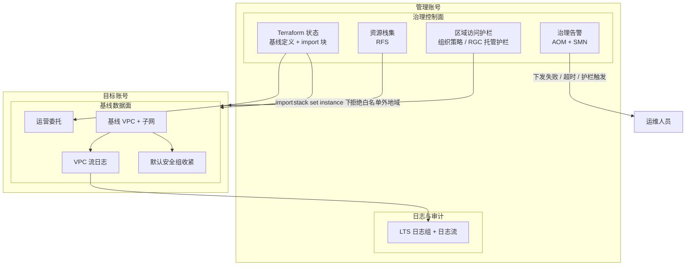

# 架构说明

> 本文说明多账号着陆区治理基线的架构构成、各组件职责，以及治理链路的运作方式。

## 一、这套架构解决什么问题

多账号环境中，每个账号都应拥有一套统一的基线配置：独立的网络边界、完整的流日志审计、固定的运维代入关系，以及一条限制区域访问的护栏。

基线配置本身并不复杂，复杂的是**基线由谁下发、由谁变更**。当下发机制与变更机制分离时，会出现三个典型痛点：

| 痛点 | 表现 | 本架构的应对 |
|---|---|---|
| 变更不可见 | 基线由平台侧统一下发，业务侧要等平台通知才知道基线变了 | 全部基线进 Terraform 状态，plan 阶段可见所有变更 |
| 漂移靠人工发现 | 线上被手工改过，无人知晓，直到出故障才暴露 | Terraform 自动检测漂移，plan 中直接呈现差异 |
| 交接会断服务 | 更换下发机制时，旧机制清理动作连带删除了基线资源，账号内网络与日志随即中断 | 先接管进状态，再移除旧机制实例，全程不删不重建 |

第三点是本架构最核心的设计约束：**接管而非重建**。

## 二、整体架构



## 三、组件职责

### 3.1 治理控制面

| 组件 | 职责 | 关键设计 |
|---|---|---|
| Terraform 状态 | 基线资源的唯一事实来源 | 资源定义与线上实际状态逐属性一致，这是零漂移校验成立的前提 |
| 资源栈集 | 把同一套基线模板批量下发到多个账号与区域 | 栈集定义、栈集部署、栈集实例三者分离；实例的创建与删除均纳入 Terraform 生命周期 |
| 区域访问护栏 | 拒绝白名单外的地域调用 | 提供两条路径：组织策略直管（可试运行）与托管治理护栏（无需跨账号组织级权限） |
| 治理告警 | 汇聚下发失败、下发超时、护栏触发三类事件 | 三类告警规则挂在同一告警策略下，通知走同一消息主题 |

### 3.2 日志与审计

VPC 流日志是治理链路可审计的基础。它投递到云日志服务的日志组与日志流两级结构中，日志流负责区分 VPC 维度，日志组负责生命周期与留存策略。

日志保留天数由 `log_retention_days` 统一控制。生产环境通常需要比开发环境更长的留存期 —— 这也是清单文件里每个账号可单独指定 `log_retention_days` 的原因。

### 3.3 基线数据面

每个受治理账号内包含四类基线资源：

| 资源 | 作用 | 关键属性 |
|---|---|---|
| 基线 VPC + 子网 | 账号内的网络边界 | 网段按账号规划，生产与非生产建议不重叠 |
| VPC 流日志 | 审计数据来源 | 流量类型为全量，投递到 LTS 日志组/日志流 |
| 默认安全组收紧 | 消除隐式全通放行 | 清空默认放通规则 |
| 运营委托 | 管理账号的只读运维代入关系 | 账号型委托，指定可代入的管理账号 |

## 四、治理链路的运作方式

### 4.1 盘点阶段

先把组织统一下发的基线抽成结构化清单。清单描述每个账号收到了哪些定制项、参数是什么、覆盖哪些区域。这份清单是后续接管与交接的共同依据 —— 没有它，就无法回答「这个账号该有什么」。

工具：`scripts/extract-manifest.py`（输出 JSON 或 CSV）。

### 4.2 接管阶段

这是整个链路中最需要小心的阶段。

**动作**：把既有基线资源通过 import 纳入 Terraform 状态。

**关键约束**：本地资源定义必须与线上实际状态**逐属性一致**。只要有一个属性对不上，plan 就会出现漂移变更。

**为什么不能直接 apply**：一旦定义有偏差而直接 apply，Terraform 会用本地定义覆盖线上配置 —— 这等于用一份可能过时的声明去改生产基线，比不接管更糟。

因此接管前必须跑零漂移校验（`scripts/verify-takeover.sh`），期望输出：

```
Plan: 5 to import, 0 to add, 0 to change, 0 to destroy.
```

任何 `to change` 或 `to destroy` 都说明定义与线上有差异，必须先修正定义。

### 4.3 交接阶段

**动作**：移除栈集实例，资源所有权转到本地 Terraform 状态。

**顺序不可颠倒**：栈集实例被移除时，其持有的资源会随之下线。资源若已接管进本地状态，移除实例不影响资源；若尚未接管，移除实例就等于删除基线资源。

本架构把「先接管、后移除」的顺序固化进脚本：`scripts/remove-stack-instances.sh` 要求操作者先声明该账号资源已完成接管，移除后立即打印资源校验命令。

### 4.4 退役阶段

拆除旧机制分五步，每步之间留观察期：

| 步骤 | 动作 | 可逆性 |
|---|---|---|
| 1 | 停用自动化下发 | 可逆 |
| — | 观察期 2-4 周 | — |
| 2 | 移除空栈集实例 | 可逆 |
| 3 | 删除栈集定义 | 可逆 |
| 4 | 删除残留资源栈 | 部分可逆 |
| 5 | 归档留痕 | **不可逆** |

第 5 步是唯一不可逆的一步，执行前需确认四项前提全部满足（见 `scripts/decommission.sh` 的提示）。

## 五、区域访问护栏的两条路径

两条路径表达同一件事：**拒绝白名单外的地域上的全部调用**。

| 维度 | 组织策略直管 | 托管治理护栏 |
|---|---|---|
| 策略内容 | 写在仓库里，随 Terraform 生命周期管理 | 由资源治理中心的内置治理策略定义 |
| 影响面评估 | 支持试运行，先评估再正式挂载 | 由托管策略自身的机制保障 |
| 权限要求 | 需组织策略管理权限 | 不需要跨账号组织级权限 |
| 变更方式 | 走代码评审 | 控制台或接口 |
| 适用场景 | 需要完全掌控策略内容与挂载目标 | 权限受限，或倾向沿用托管策略的标准语义 |

组织策略的试运行能力值得单独一提：护栏一旦挂载到生产组织单元，影响的是该单元下所有账号的全部调用。策略内容写错一个条件键，影响范围极大。**先试运行、再正式挂载**是把这类风险降到最低的做法。

## 六、账号纳管与身份标识

账号纳管由资源治理中心承载。纳管时通过 `identity_store_email` 与 `identity_store_user_name` 指定该账号在统一身份认证中的用户标识。

这个设计带来两个好处：账号开通与既有账号纳管走同一套机制，无需分别实现；纳管关系本身就把账号与身份标识绑定，后续的权限授予不必再单独维护一份账号到用户的对照表。

## 七、已知的能力边界

| 边界 | 说明 | 应对 |
|---|---|---|
| 运营委托无二次校验条件 | 华为云的委托模型不支持在信任关系上附加「必须携带多因子认证信息」这类条件 | 代入操作通过云审计服务留痕，事后可追溯 |
| 栈集实例需独立创建 | 资源编排服务的「栈集定义」「栈集部署」与「栈集实例创建」是三个动作，前两者不会自动产生实例 | 已通过脚本补齐并纳入 Terraform 生命周期 |
| 单栈销毁保留需显式开启 | 资源栈的保留开关默认关闭，销毁会连同资源一起删除 | 交接场景统一采用「先接管进状态、再移除实例」，避免依赖销毁保留 |
| 栈集模板不可原地更新 | 模板内容提交后，服务端不支持对既有栈集更新模板 | 提供替换开关，变更转为「销毁旧栈集与部署 + 重建」；注意替换会中断已存在的下发实例 |
| 栈集下发需双账号拓扑 | 云侧禁止委托自代入，栈集下发要求「管理账号 + 成员账号」 | 属云平台侧的架构约束而非配置项；下发前须准备好两个账号及相互信任关系 |
| 委托角色回读受限 | 委托的域级角色由独立接口回读，该接口对缺少委托读取权限的身份返回 403 | 该字段已让出变更比对，角色是否落地以控制台委托详情为准 |
| 部分区域告警规则接口不可用 | 告警规则创建在部分区域返回服务端内部错误 | 告警默认关闭，开启前先在目标区域单条验证 |

关于第二点与第三点：多账号下发场景中，资源实例由栈集持有，因此**实例的创建本身就必须显式触发**。本架构把这一步接入 Terraform 的 `terraform_data` 资源，使创建与删除都随 apply/destroy 一起发生，不会出现「栈集建好了但目标账号里什么都没有」的情况。

## 八、与多区域部署的关系

同一套基线需要在多个区域落地时，为每个区域声明一个 provider 别名，模块通过显式传入 provider 的方式使用对应区域的能力（见 `infra/multi-region.tf`）。

注意两个区域之间是**完全独立**的基线：各自的 VPC、各自的流日志、各自的日志底座。日志不跨区域汇聚是刻意的设计 —— 跨区域的集中存储会引入额外的合规边界，通常需要在安全方案中单独论证。

## 九、敏感参数的处理

基线配置中需要保密的取值（访问凭据、令牌、加密口令）不写入模板参数与变量文件，改为存放在密钥管理服务中，由部署侧按需读取。

这样做的收益：

- 基线模板可以安全地纳入版本管理，评审时不必担心泄露
- 密钥的轮换与吊销不需要改动基线定义
- 密钥的访问被记录为审计事件，谁在什么时间取了哪个密钥可追溯

密钥容器输出只包含标识与版本号，不输出明文取值。
